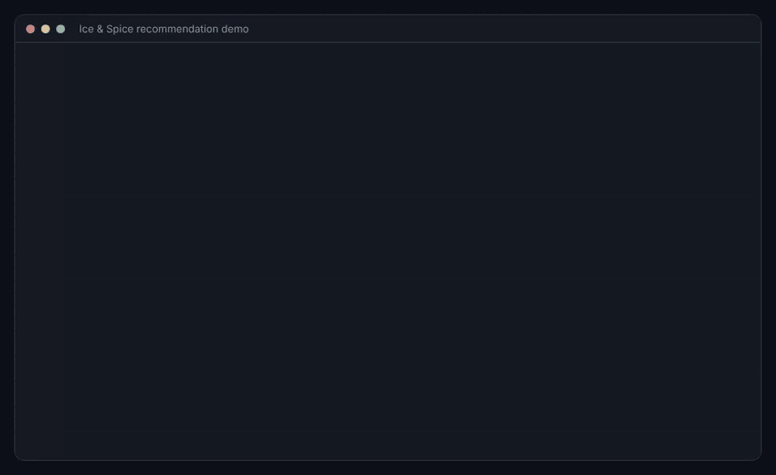

# Ice & Spice Restaurant Recommendation System


A Java console demo of a menu recommendation engine for a fictional restaurant ("Ice & Spice"), built around an object-oriented design: abstract preference and feedback analyzers, a recommendation engine that composes them, user profiles, menu categories, inventory, offers and a popularity tracker. An optional Python component trains a small collaborative-filtering model and can be called from Java.

This started as a group university project. `Inventory` was a stub left for another team member and has been filled in with a simple per-item stock map.

## Run the demo

Needs JDK 11 or later.

```bash
./build.sh
./run.sh
```



*Output of `./run.sh`, replayed line by line in a terminal-style frame.*

`Main` builds a 15-item menu, four user profiles and two offers, then prints the top three recommendations per user and processes one piece of feedback. Each persona gets a different list:

| Persona | Profile | Top three |
|---|---|---|
| Budget-conscious student | budget ₹15 to ₹80, likes spicy | Pav Bhaji, Chicken Shawarma, Vada Pav |
| Health-conscious vegetarian | vegetarian, egg allergy, likes healthy | Fresh Juice, Brownie, Pastry |
| Sweet tooth | likes sweet, prefers desserts | Brownie, Pastry, Paneer Cheese Sandwich |
| Non-vegetarian food lover | prefers the non-vegetarian category | Chicken Burger, Chicken Shawarma, Chicken Fried Rice |

## How a recommendation is made

1. **Filter (hard rules).** An item is dropped if it is unavailable or out of stock, unsuitable for the context, contains one of the user's allergens, or is not vegetarian/vegan when the user is. These rules apply to every user, with or without order history. They are filters and never part of the score, so no score can outweigh an allergy.
2. **Score (soft preferences).** `ContentBasedPreferenceAnalyzer` gives each remaining item a score in [0, 1], a weighted average of five components: price in budget (0.30), spice fit (0.25), category preference (0.20), preferred tags (0.15) and vegetarian match (0.10). A component is neutral (0.5) when the user has said nothing about it.
3. **Rank.** Best score first. Ties go to the higher-rated item, then to item id, so the same inputs always give the same list.

Which ranking is used depends on what is known about the user:

| User | Ranking | `algorithmUsed` |
|---|---|---|
| Has order history | preference score | `Hybrid` |
| Has a profile, no orders yet | preference score | `Cold Start - Profile Match` |
| Unknown | highest rated | `Cold Start - Popular Items` |

## Tests

```bash
./test.sh
```

Runs 25 JUnit 5 tests (engine, scorer, menu item). The script downloads the JUnit console launcher into `build/test-lib/` on first run; there is no other dependency. CI runs the tests and the demo on JDK 11 and 21.

## Python ML component (optional)

```bash
cd python
python3 -m venv .venv && source .venv/bin/activate
pip install -r requirements.txt
python test_ml.py
```

`ml_integration.py` generates sample interaction data on first use and fits an item/user similarity model. It writes `is.db` and `models/` into the current directory (both git-ignored). `java_python_bridge.py` reads one JSON request from stdin and prints one JSON response; `src/ml/MLPredictionService.java` calls it from Java. That Java class needs the Jackson databind jars in `lib/` (Jackson is not bundled), and the Python script path is relative to the repository root. The demo in `Main` does not use it.

## Layout

```
src/Main.java          demo entry point
src/engine/            RecommendationEngine, UserProfileManager
src/analyzer/          preference analyzers (content-based, collaborative) and feedback analyzers
src/model/             MenuItem, MenuCategory, Offer, Order, Inventory, UserPreferences, ...
src/filter/            RecommendationFilter
src/tracker/           PopularityTracker
test/                  JUnit 5 tests
src/ml/                Java client for the Python component
python/                collaborative-filtering model and bridge
```

## Limitations

- The demo users have no order history, so they are ranked from their stated profile only. The history-based path is covered by tests, not by the demo.
- The score weights are hand-picked, not learned from data.
- Allergen matching is a substring match on ingredient names; it does not know that, for example, mayonnaise contains egg.
- The collaborative filter in `python/` is trained on generated sample data, not real orders, and `python/test_ml.py` is a smoke script.
- Profiles, orders and stock live in memory; nothing is persisted.
